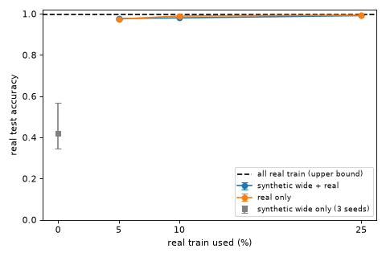

# citrus-sim2real-grading

Grading oranges as fresh, green or defective with a CNN, and testing whether a model trained only on synthetic Blender renders works on real photos.

## Goal

Fruit-grading cameras normally need thousands of hand-labelled photos. This project tests whether synthetic images rendered in Blender, where the label comes free from the render parameters, can replace that labelling. The headline result is the sim-to-real gap: accuracy on real fruit for a model trained only on synthetic images, compared with a baseline trained on real images, and what closes the gap.

## Results

Every number here comes from a logged run: test results in `results/experiments.csv` (summary in `results/stage3_summary.csv`), per-epoch train and val numbers in `results/<run_id>_history.csv`. Accuracy is on the real test set: 1,350 images, 450 per grade, so accuracy equals balanced accuracy. Where a setting has 3 seeds (42, 43, 44) the table gives the mean and the min to max range.

| Trained on | Real test acc |
|---|---|
| All real train, 6,300 images (upper bound) | 0.9985 |
| Synthetic only, narrow (3 seeds) | 0.4667 (0.4356 to 0.4874) |
| Synthetic only, wide (3 seeds) | 0.4207 (0.3437 to 0.5659) |
| 5% real train, 315 images (3 seeds) | 0.9743 (0.9704 to 0.9800) |
| Synthetic wide, then 5% real (3 seeds) | 0.9770 (0.9733 to 0.9793) |
| 10% real / synthetic wide, then 10% real | 0.9889 / 0.9800 |
| 25% real / synthetic wide, then 25% real | 0.9933 / 0.9911 |

The same fruit appears in real train and real test, so every number that uses real training data is optimistic (see Limitations).



### Findings

- **The sim-to-real gap is large.** Synthetic-only wide scores 0.4207, 57.8 points below the upper bound and close to chance (0.33).
- **Synthetic-only models call almost everything defective.** Across the 6 runs they get every real defective orange right but only 3 to 52% of fresh and 0 to 18% of green, predicting defective for 1,036 to 1,336 of 1,350 images. My reading: synthetic fresh and green fruit are smooth uniform spheres, so the model learned that any colour or texture variation means defective, and real healthy fruit has pores, marks, stems and leaves.
- **Synthetic val is no guide to real performance.** Synthetic val reached 0.996 to 1.0 in every run while real test stayed between 0.34 and 0.57. In wide seeds 42 and 44, real val fell from 0.53 and 0.67 at the end of head-only training to 0.34 and 0.35 after full fine-tuning (`results/synth_*_history.csv`).
- **Narrow vs wide: no clear difference.** Narrow is 4.6 points ahead, but the bar set before the runs was 2x the larger seed range (44.4 points). Wide seeds ranged from 0.34 to 0.57, so a single seed could have supported either conclusion.
- **Real images closed the gap, synthetic pretraining did not add to it.** 315 real images reach 0.97. Starting from the synthetic model instead of ImageNet made no clear difference at 5%, 10% or 25% (all within the 2-point bar). Fine-tuning also erased the synthetic skill: synthetic val fell from 0.96 to 0.62 in the 5% seed 42 run (`results/mixed_wide_5_s42_history.csv`).
- **Attention stays on the fruit.** In `results/gradcam_compare.png` (7 real val images, 4 models), all heatmaps sit on the fruit, none on the background. On fresh fruit with leaves, the synthetic models put weight on the stem and leaf and call it defective.

Hypotheses were written in `docs/spec_sim2real.md` before any run. H1 (synthetic-only well above chance with a clear gap, green the easiest grade) was mostly not supported: only the clear gap held, while accuracy was close to chance and green was the worst grade, not the easiest. H2 (wide beats narrow) and H4 (synthetic pretraining helps most with little real data) were not supported. H3 (defect types differ) could not be tested, since all defect types scored 1.0 by being called defective. H5 held on the 7 images checked: attention is on the fruit as predicted, with more weight on stems, leaves and shaded regions than the real model.

## Limitations

- Blender rigid-body physics is used only for natural resting poses. It is not DEM and does not model fruit-to-fruit contact or bulk flow.
- The real-data baseline is an upper bound. The split groups augmented copies of the same photo together, but the dataset also contains the same physical orange photographed several times, and those photos can land in different splits. Spot checks found val images whose closest train image is clearly the same fruit. So the real baseline partly measures recognising seen fruit, and the sim-to-real gap is likely overstated. Testing on an independent orange dataset would give an honest number and is left as future work.
- The 5%, 10% and 25% subsets come from real train, which shares fruit with real test. Real-only and mixed runs use the same subsets, so the comparison between them is fair, but both absolute numbers are optimistic.
- The real test set is one dataset from one source: phone photos on white or grey backgrounds. Good results here would not show transfer to a grading machine's camera.
- Narrow vs wide is not pure variety against none. Narrow is styled like the real photos (light background, top-down camera), so the comparison is "matched but narrow" against "varied but less matched".
- Synthetic colour ranges were set from real train colour statistics (Stage 2). No real labels picked any checkpoint or epoch count: every Stage 3 run keeps its last epoch of a fixed 5+5.
- During head-only training the backbone weights are frozen, but BatchNorm running statistics still update, so real images are normalised with statistics from synthetic images. This is the same recipe as the real baseline and was kept unchanged.
- One model (ResNet18), one recipe, no hyperparameter search. Mixed vs real-only at 10% and 25% has one seed each, and the noise estimate comes from the 5% seed ranges.
- The Grad-CAM comparison covers 7 images and is a qualitative check, not a measurement.

## Next steps

- Healthy-fruit texture: pores, blemishes, stems and leaves on synthetic fresh and green fruit, to break the "variation means defective" shortcut.
- Physically based peel materials and captured real lighting, instead of hand-set ranges.
- DEM-calibrated fruit motion on the belt, instead of rigid-body resting poses.
- AdaBN (Li et al. 2016): re-estimate BatchNorm statistics on unlabelled real images, a cheap domain adaptation step.
- An independent real test set with no fruit shared with training.

## Data

Real images: *Orange Fruit Image Dataset for Classification*, Mendeley Data, DOI [10.17632/zk4hzhtcdd.2](https://doi.org/10.17632/zk4hzhtcdd.2). Licensed under CC BY 4.0.

## Setup

```
uv sync
```

Blender (current LTS) runs headless as `blender`. On a Mac, alias it to `/Applications/Blender.app/Contents/MacOS/Blender`.

## Pipeline

Run from the repo root, in this order. Every script uses seed 42 unless `--seed` is given.

**Stage 1: real baseline.** Download the dataset to `data/real/raw/` first.

```
uv run python src/prepare_real.py          # 3 grades, duplicate groups, 70/15/15 split CSVs
uv run python src/dataset.py               # results/sample_real.png sanity grid
uv run python src/train.py --train-source real --run-id real_lrb1e-4
uv run python src/evaluate.py --checkpoint checkpoints/real_lrb1e-4.pt --notes "real baseline"
```

**Stage 2: Blender generator.** Shown for wide; narrow is the same with `narrow` / `narrow_v2`.

```
uv run python src/make_scene_params.py --randomisation wide --n-per-grade 1000 --out-dir data/synthetic/wide_v2
for start in 0 500 1000 1500 2000 2500; do
  blender -b -P blender/generate.py -- --labels data/synthetic/wide_v2/labels.csv --start $start --count 500
done
uv run python src/camera_process.py --labels data/synthetic/wide_v2/labels.csv
uv run python src/split_synthetic.py --synthetic-dir data/synthetic/wide_v2
uv run python src/synthetic_report.py --synthetic-dir data/synthetic/wide_v2
```

**Stage 3: sim-to-real.** Training output is saved to `logs/<run_id>.log` for `parse_logs.py`. Each run is evaluated once.

```
mkdir -p logs

# 3.1 and 3.2: synthetic only, narrow and wide, seeds 42 to 44
for setting in wide narrow; do for seed in 42 43 44; do
  uv run python src/train.py --train-source synthetic --synthetic-dir data/synthetic/${setting}_v2 \
    --seed $seed --run-id synth_${setting}_s${seed} | tee logs/synth_${setting}_s${seed}.log
  uv run python src/evaluate.py --checkpoint checkpoints/synth_${setting}_s${seed}.pt
done; done

# 3.3: nested 5/10/25% real subsets, then real-only and mixed runs on the same subset
uv run python src/make_real_subsets.py
for run in 5:42 5:43 5:44 10:42 25:42; do
  pct=${run%%:*}; seed=${run##*:}
  uv run python src/train.py --train-source real --real-fraction $pct --seed $seed \
    --run-id real_${pct}_s${seed} | tee logs/real_${pct}_s${seed}.log
  uv run python src/evaluate.py --checkpoint checkpoints/real_${pct}_s${seed}.pt
  uv run python src/train.py --train-source mixed --real-fraction $pct --seed $seed \
    --synthetic-dir data/synthetic/wide_v2 --init-checkpoint checkpoints/synth_wide_s${seed}.pt \
    --run-id mixed_wide_${pct}_s${seed} | tee logs/mixed_wide_${pct}_s${seed}.log
  uv run python src/evaluate.py --checkpoint checkpoints/mixed_wide_${pct}_s${seed}.pt
done

# 3.4: summary table, real-fraction plot, difference rule, Grad-CAM comparison, per-epoch history
uv run python src/compare_runs.py
uv run python src/parse_logs.py
```
